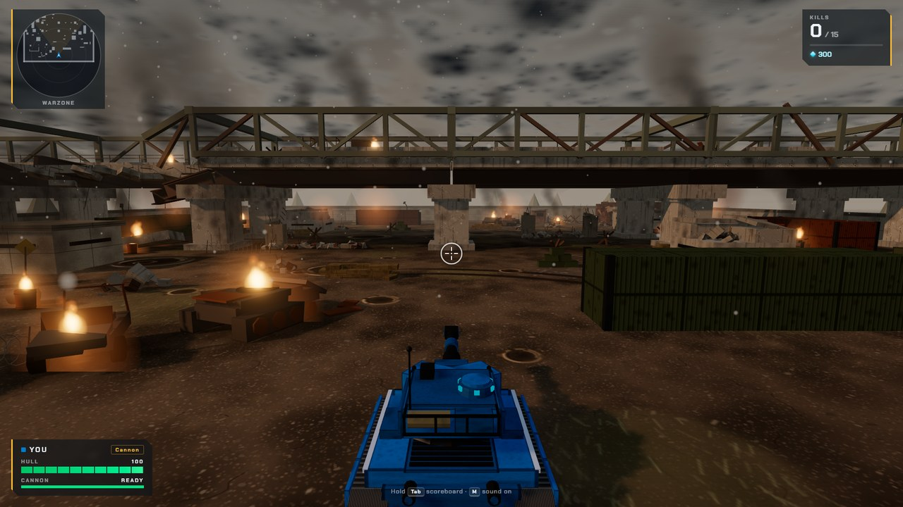
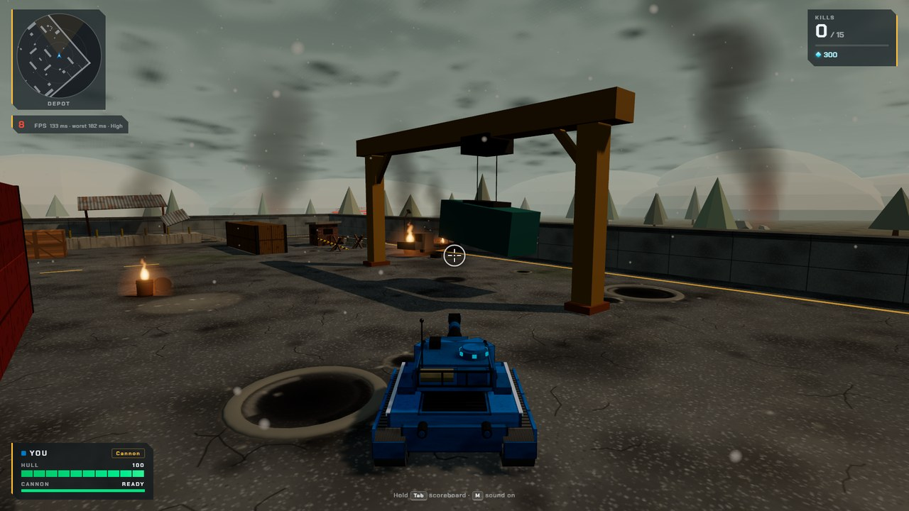
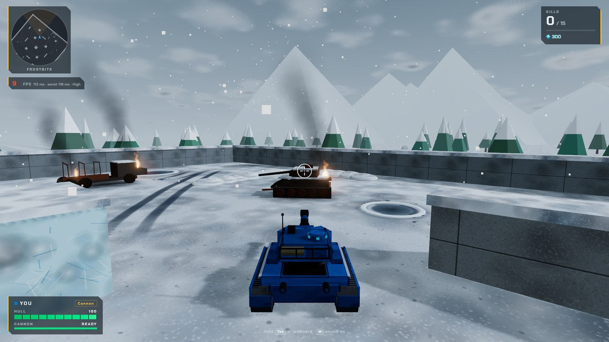

# Treadstorm

A 3D tank arena that runs in your browser: drive, aim a separate turret, and fight bots or other people online.
Built with plain JavaScript and [three.js](https://threejs.org), with a small Node server for multiplayer.



**Play it:** https://meno-g.itch.io/treadstorm

## Features
- **4 maps:** Quarry, Depot, Frostbite and Warzone (a huge collapsed overpass, ruins, fires, a smoky sky).
- **3 hulls and 7 turrets:** Cannon, Blaster, Railgun, Flamer, Freezer, Ricochet and Hammer (a shotgun), each with its own sound and effects.
- **3 modes:** Free-for-all, Team Deathmatch and Capture the Flag, with bots that path-find and play the objective.
- **Garage:** earn crystals from kills, wins and crates, and upgrade your hull and turret.
- **Bonus crates:** repair, double armor, double damage, nitro and crystals drop by parachute.
- **Online multiplayer:** a lobby with rooms, up to 8 players per team match, smooth movement for other players, and instant response for your own tank (client-side prediction).
- **Graphics settings:** Auto, Low, Balanced and High, tuned to run on modest laptops. Press `F` for an FPS counter.

| | |
|---|---|
|  |  |

## Controls
| Key | Action |
|---|---|
| `W` `S` | Drive forward / reverse |
| `A` `D` | Rotate hull |
| `Z` `X` | Rotate turret (`C` centers it) |
| `Space` | Fire |
| `Q` `E` | Zoom out / in |
| `Tab` | Scoreboard |
| `M` | Sound on / off |
| `F` | FPS display |
| `Esc` | Menu / pause |

## Run it yourself
You need [Node.js](https://nodejs.org) 20 or newer.

```bash
npm install
npm run dev          # the game at http://localhost:5173
```

To play online on your own computer, start the game server in a second terminal:

```bash
npm run server       # builds and starts the server on ws://localhost:8787
```

Open the game, type a name and press **Join online** (or **Rooms** to pick or open a room). Open a second browser tab to play against yourself.

Build the web version: `npm run build` (output in `dist/`, works from any folder or itch.io).

## How multiplayer works
The server runs the game's own rules (`main.js`, with stand-ins for everything a browser provides) and is the only one that decides health, kills and scores. Browsers send the keys you hold and draw what the server reports.
Every room is a separate match running in its own thread. Other players are drawn a short moment in the past so their movement is smooth, while your own tank is driven locally and gently corrected by the server.
The details (protocol, rooms, prediction, limits) are in [server/README.md](server/README.md).

## Put your own server online
See [DEPLOY-SERVER.md](DEPLOY-SERVER.md). It includes a `Dockerfile` and a `render.yaml` for a free Render.com server, and shows how to bake your server address into the web build (`VITE_SERVER_URL=wss://your-server npx vite build`). Hosting the game page itself is covered in [DEPLOY.md](DEPLOY.md), and adding maps and props in [ENVIRONMENT.md](ENVIRONMENT.md).

## Tests
```bash
npm run build:server
node server/tests/fake-clients.mjs   # 60+ checks with scripted players
node server/tests/load-meter.mjs     # how steady the server loop is under load
```

## Project layout
| Path | What it is |
|---|---|
| `main.js` | The whole game: maps, tanks, weapons, bots, HUD, sound, and the online client |
| `index.html`, `style.css` | Menus and HUD |
| `server/entry.js` | The lobby: connections, rooms, limits |
| `server/room.js` | One game room (a match) |
| `server/stubs/` | Browser stand-ins that let `main.js` run in Node |
| `public/models/` | Turret models (GLB) |

## Credits
Built with [three.js](https://threejs.org) and [ws](https://github.com/websockets/ws). The Freezer, Ricochet and Hammer turret models were generated with Hyper3D Rodin and optimized for the web. Sound is synthesized in code; there are no audio files.

## License
[MIT](LICENSE) © 2026 Meno-G. The code and the included game assets (turret models, textures generated in code) may be used, changed and shared under it.
